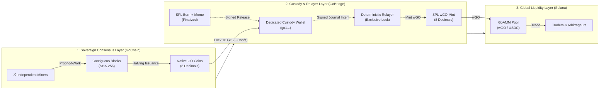

# GO Cross-Chain Liquidity Specification

**Document Version:** 1.0.0  
**Status:** Formal Protocol Specification  
**Reference Implementations:**  
- Sovereign Blockchain: `C:\Projects\nothingchain` (GoChain PoW Consensus)  
- Solana Liquidity: `C:\Projects\goamm` (GoAMM Automated Market Maker)  
- Cross-Chain Custody Laboratory: `C:\Projects\nothingchain\solana-devnet` (GoBridge Relayer)

---

## 1. System Vision & Architecture

The GO Cross-Chain Liquidity Protocol decouples **currency creation** (native Proof-of-Work mining on an independent sovereign ledger) from **currency trading and utility** (global automated market makers on high-throughput execution networks).



---

## 2. Native GO Consensus & Canonical Asset Identity

### 2.1 Currency Arithmetic & Atomic Precision
- **Atomic Precision:** 1 GO = $100,000,000$ integer atomic units ($10^8$ atoms).
- **Consensus Types:** All internal account balances, transaction inputs, block rewards, and bridge payloads must be signed 64-bit integers (`int64` / `u64`). Floating-point arithmetic is strictly prohibited in consensus and bridge accounting.
- **Display Representation:** Floating-point or string amounts (e.g., `"10.00000001"`) are parsed strictly into exact integer atoms before entering the state machine.

### 2.2 Proof-of-Work & Issuance Schedule
- **Hashing Algorithm:** Continuous SHA-256 over canonical deterministic Go JSON encoding:
  $$\text{BlockHash} = \text{SHA256}(\text{JSON}(\text{chain, index, timestamp, txs, prev\_hash, nonce, miner, reward\_atoms}))$$
- **Consensus Rule:** Leading 16 bits zero (work target: `0000...`).
- **Issuance Rule:** Initial block reward is $1,000,000,000\text{ atoms}$ ($10\text{ GO}$). Rewards halve on Gregorian February 29 leap-day cutoffs (2028, 2032, 2036... excluding 2100). Transfers strictly conserve supply.
- **Maturity & Pre-mine:** Zero pre-mine. Mining rewards are credited after transactions in a block; rewards cannot fund transactions within the same block.

### 2.3 Trusted Checkpoint Finality
- **Chain Domain:** `gochain-checkpoint-amm-test-v1` (or canonical network ID).
- **Authority Certificate:** An Ed25519 checkpoint certificate signed by the designated authority binds `chain_id`, `block_height`, `block_hash`, and `issue_timestamp`.
- **Policy Enforcement:** Nodes reject conflicting histories irrespective of accumulated work. Checkpoint certificates expire if older than 24 hours or if a halving boundary is crossed without renewal.

---

## 3. Solana Wrapped GO (wGO) Asset Identity

### 3.1 Token Standard & Mint Policy
- **Token Standard:** Standard Solana SPL Token (`TokenkegQfeZyiNwAJbNbGKPFXCWuBvf9Ss623VQ5DA`).
- **Decimals:** Exactly **8 decimals**, identical to native GoChain. This guarantees a 1:1 atomic mapping between native GoChain atoms and Solana token base units:
  $$1\text{ atom on GoChain} \equiv 1\text{ base unit on Solana SPL}$$
  Zero scaling conversions, zero precision loss, and zero dust rounding.
- **Freeze Authority:** Explicitly `None`. wGO tokens are completely unfreezable and permissionless once minted.
- **Mint Authority:** Controlled exclusively by the verified Bridge Operator / PDA keypair.

---

## 4. Custody & Relayer Architecture

### 4.1 Dual-Custody Endpoints
1. **GoChain Custody:** A dedicated GoChain address (`go1...`) controlled by the bridge signer.
2. **Solana Authority:** A dedicated Solana keypair or Program Derived Address (PDA) holding the `mint_authority` of the 8-decimal `wGO` SPL mint.

### 4.2 Durable Journal & Write-Ahead State Machine
Every bridge action is governed by an append-only, fsynced on-disk journal (`journal.json`):
1. **Exclusive Advisory Locking:** An exclusive directory-level file lock (`operator.lock`) ensures that exactly one relayer process can access or mutate bridge state.
2. **Write-Ahead Intent:** Before any transaction is signed or broadcast to either network, the relayer records its full intent (`id`, `requestHash`, `kind`, `atoms`, `signatures`, `targetAddress`).
3. **Deterministic Idempotency:** The relayer never generates a replacement signature or advances a nonce for an unresolved operation. Recovery always inspects the exact recorded signature.

---

## 5. Formal State Machines

### 5.1 Deposit State Machine (GoChain $\to$ Solana wGO)

```mermaid
stateDiagram-v2
    [*] --> OBSERVED_GO_TX: User submits GO transfer to custody with memo
    OBSERVED_GO_TX --> CONFIRMING_GO: Included in GoChain block H
    CONFIRMING_GO --> FINALIZED_GO_DEPOSIT: Reaches >= 3 GoChain confirmations (H+2)
    FINALIZED_GO_DEPOSIT --> PENDING_SOL_MINT: Audit confirms Surplus >= Deposit; sign Solana Mint Tx
    PENDING_SOL_MINT --> BROADCAST_SOL_MINT: Send raw tx to Solana RPC
    BROADCAST_SOL_MINT --> FINALIZED_SOL_MINT: Confirmed at 'finalized' commitment
    FINALIZED_SOL_MINT --> COMPLETED_WRAP: Record finalized slot; mark done: true
    COMPLETED_WRAP --> [*]
```



| State | Entry Condition | Exit Condition / Trigger | Failure / Recovery Action |
| :--- | :--- | :--- | :--- |
| `OBSERVED_GO_TX` | GoChain transaction broadcast with `bridge-wrap:<id>:<sol_pubkey>`. | Transaction included in block at height $H$. | If dropped from mempool, re-broadcast identical signed bytes. |
| `CONFIRMING_GO` | Block $H$ accepted by node. | Chain advances to height $\ge H + 2$ with valid checkpoint. | If reorg occurs, halt relayer immediately. |
| `FINALIZED_GO_DEPOSIT` | Height $\ge H + 2$ reached. | Solvency audit passes ($\text{Surplus} \ge \text{Atoms}$). Prepare Solana mint instructions. | If surplus insufficient, halt with `INSUFFICIENT_BACKING`. |
| `PENDING_SOL_MINT` | Mint transaction signed with exact blockhash and recent expiry. | Intent fsynced to journal. | If relayer crashes, reload exact raw transaction bytes. |
| `BROADCAST_SOL_MINT` | Raw transaction submitted via `sendRawTransaction`. | Transaction received and recognized by cluster. | If RPC drops, retry broadcast with exact same signature. |
| `FINALIZED_SOL_MINT` | Transaction achieves `finalized` status (31+ confirmation slots). | Finalized slot number recorded to journal. | If transaction failed on-chain, fail closed; require operator audit. |
| `COMPLETED_WRAP` | Journal fsynced with `done = true`. | Operation marked complete. | Unlocks relayer for subsequent operations. |

---

### 5.2 Withdrawal State Machine (Solana wGO $\to$ Native GoChain)

```mermaid
stateDiagram-v2
    [*] --> SUBMITTED_SOL_BURN: User executes SPL Burn + SPL Memo
    SUBMITTED_SOL_BURN --> CONFIRMING_SOL_BURN: Transaction accepted by Solana cluster
    CONFIRMING_SOL_BURN --> FINALIZED_SOL_BURN: Reaches 'finalized' commitment (31+ slots)
    FINALIZED_SOL_BURN --> PENDING_GO_RELEASE: Audit validates custody; sign GoChain release tx
    PENDING_GO_RELEASE --> BROADCAST_GO_RELEASE: Submit signed release to GoChain node
    BROADCAST_GO_RELEASE --> CONFIRMING_GO_RELEASE: Included in GoChain block H
    CONFIRMING_GO_RELEASE --> COMPLETED_UNWRAP: Reaches >= 3 GoChain confirmations (H+2)
    COMPLETED_UNWRAP --> [*]
```



| State | Entry Condition | Exit Condition / Trigger | Failure / Recovery Action |
| :--- | :--- | :--- | :--- |
| `SUBMITTED_SOL_BURN` | User burns $N$ wGO with Memo `bridge-release:<id>:<go_address>`. | Transaction signature emitted. | If unsubmitted, user wallet retains tokens. |
| `CONFIRMING_SOL_BURN` | Signature seen on-chain. | Cluster processes block. | If rejected preflight, operation aborted. |
| `FINALIZED_SOL_BURN` | Transaction reaches `finalized` commitment with `err == null`. | Extract recipient, amount, and finalized slot. Verify memo binds operation ID. | Pruned history accepted ONLY if prior finalized receipt exists on disk. |
| `PENDING_GO_RELEASE` | Backing audit confirms solvency. | Custody signs transfer from `custody` to `go_address` with next valid nonce. | Journal fsynced before GoChain submission. |
| `BROADCAST_GO_RELEASE` | Transaction sent via `/tx` to GoChain node. | Node admits transaction to mempool. | If node offline, retry identical signature upon reconnection. |
| `CONFIRMING_GO_RELEASE` | Transaction included in block at height $H$. | Height advances to $\ge H + 2$. | Incurred liability tracked as `confirming_release` in audit. |
| `COMPLETED_UNWRAP` | Block $H$ reaches 3 confirmations. | Operation marked `done: true` in journal. | Complete release; custody obligation retired. |

---

## 6. Mathematical Conservation & Solvency Invariants

### 6.1 Definitions
* $B_{\text{custody}}$: Total atomic units of native GO confirmed in the custody address on GoChain.
* $S_{\text{wGO}}$: Total atomic supply of SPL `wGO` reported by the Solana SPL Token Mint.
* $L_{\text{pending\_release}}$: Total atomic units burned on Solana with `finalized` status whose corresponding GoChain release has $< 3$ confirmations.
* $D_{\text{pending\_mint}}$: Total atomic units deposited on GoChain with $\ge 3$ confirmations whose corresponding Solana mint is not yet `finalized`.

### 6.2 Core Solvency Invariant
At all times, the confirmed native custody must strictly cover or exceed all active and in-flight wrapped claims:
$$\boxed{B_{\text{custody}} \ge S_{\text{wGO}} + L_{\text{pending\_release}}}$$

Equivalently, the unallocated surplus is defined as:
$$\text{Surplus}_{\text{atoms}} = B_{\text{custody}} - \left(S_{\text{wGO}} + L_{\text{pending\_release}}\right)$$

### 6.3 Issuance Guard
The relayer is mathematically forbidden from signing or broadcasting a Solana mint instruction unless:
$$\text{Surplus}_{\text{atoms}} \ge D_{\text{pending\_mint}}$$
If $\text{Surplus}_{\text{atoms}} < D_{\text{pending\_mint}}$, the bridge triggers an immediate **HALT** condition (`INSUFFICIENT_BACKING`).

### 6.4 Non-Duplication of Release Liabilities
When a GoChain release is included in a block ($1$ confirmation), the custody balance $B_{\text{custody}}$ is reduced by $N$ on that block. To prevent double-counting this liability, the audit formula dynamically reconciles operations whose release transaction is already included:
$$L_{\text{pending\_release}} = \sum_{\substack{o \in \text{Unwraps} \\ o.\text{done} = \text{false} \\ o.\text{goTx} \notin \text{Blocks}}} o.\text{atoms}$$

---

## 7. Replay Prevention & Reorganization Handling

### 7.1 Cross-Chain Replay & Memo Binding
* **Wrap Deposition:** Every GoChain deposit includes a mandatory memo:
  $$\text{Memo} = \texttt{"bridge-wrap:"} \parallel \text{UUID} \parallel \texttt{":"} \parallel \text{SolanaPublicKey}$$
  A deposit without this exact format is treated as an unallocated donation to custody and cannot trigger a mint.
* **Unwrap Burning:** Every Solana burn must include an SPL Memo instruction:
  $$\text{Memo} = \texttt{"bridge-release:"} \parallel \text{UUID} \parallel \texttt{":"} \parallel \text{GoChainAddress}$$
  The memo is cryptographically signed by the token burner, preventing third parties from redirecting funds.

### 7.2 Reorganization Anchoring
For every operation verified on GoChain, the relayer records an immutable anchor:
$$\text{Anchor} = \{ \text{height}: H, \; \text{hash}: \text{BlockHash}_H \}$$
Upon every cycle of `networks()`, the relayer compares the loaded chain against all recorded anchors:
$$\forall o \in \text{Journal}, \quad \text{Block}[o.\text{anchor.height}].\text{hash} == o.\text{anchor.hash}$$
If any anchor hash differs, the relayer triggers `HALT_CRITICAL_REORG`. It stops all mints and releases, refusing to operate on a reorganized history until an operator intervenes.

### 7.3 Solana Pruned History Handling
Because Solana RPC validators periodically prune historic ledger transactions, the relayer records the exact `finalizedSlot` upon observing finality. If `getSignatureStatuses` subsequently returns `null` for a historical transaction, the signature is accepted **only if**:
$$\text{finalizedSlot} < \text{RPC}.\text{getFirstAvailableBlock}()$$
If an unconfirmed or unresolved transaction signature vanishes, the relayer halts rather than assuming success.

---

## 8. Public Proof-of-Reserves Audit Interface

The protocol exposes an unauthenticated, read-only audit endpoint and CLI command (`audit`) that computes and returns:

```json
{
  "valid": true,
  "custody_atoms": "1000000000",
  "custody_display": "10.00000000",
  "supply_atoms": "500000000",
  "supply_display": "5.00000000",
  "pending_burns_atoms": "0",
  "confirming_release_atoms": "0",
  "surplus_atoms": "500000000",
  "surplus_display": "5.00000000",
  "backing_ratio": "2.00000000",
  "status": "HEALTHY_FULL_RESERVE"
}
```

Any external observer can independently verify solvency by querying:
1. GoChain RPC: `GET /balance/<custody_address>`
2. Solana RPC: `getTokenSupply(<wgo_mint_pubkey>)`
3. Verifying: $\text{custody\_atoms} \ge \text{supply\_atoms}$.

---

## 9. Emergency Controls & Safety Halts

The protocol enforces automatic fail-closed circuit breakers:
1. **Solvency Violation:** $\text{Custody} < \text{Supply} \implies \text{HALT}$.
2. **Reorganization Detected:** Anchor hash mismatch $\implies \text{HALT}$.
3. **Ledger Identity Mismatch:** Genesis hash change on either chain $\implies \text{HALT}$.
4. **RPC Communication Timeout:** $> 15\text{s}$ unresponsive endpoint $\implies \text{HALT}$.
5. **Mint Authority Policy Breach:** Mint decimals $\ne 8$ or freeze authority enabled $\implies \text{HALT}$.
6. **Concurrent Process Contention:** Advisory lock collision $\implies \text{FAIL FAST}$.

---

## 10. Conclusion & Acceptance Criteria for Devnet Implementation

To advance to public Solana Devnet execution (Phase 3), the reference implementation must satisfy:
- [x] Exact 8-decimal lock, mint, burn, and release accounting ($0$ atoms lost to rounding).
- [x] Minimum 3 GoChain confirmations enforced before Solana mint execution.
- [x] Solana `finalized` commitment status enforced before GoChain custody release.
- [x] Crash-recovery reproduces exact signed raw transactions without duplicate broadcast.
- [x] Reorg detection halts relayer before invalid issuance can occur.
- [x] Solvency invariant $\text{Custody} \ge \text{Supply} + \text{Pending}$ verified at every state transition.
