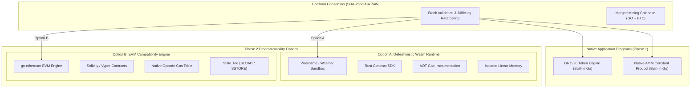

# GoChain RFC 002: Smart Contract Runtime Architecture (Phase 2)
## Deterministic WebAssembly (Wasm) vs. Ethereum Virtual Machine (EVM) Compatibility

- **Status**: Draft / Proposed
- **Author**: Antigravity & Bitproof Engineering
- **Date**: October 2026
- **Target**: GoChain Layer 1 Consensus Engine

---

## 1. Executive Summary & Context

With the successful deployment and verification of **Phase 1: GRC-20 Native Token Standard**, GoChain has transitioned from a mined cryptocurrency secured by Bitcoin AuxPoW into an asset-issuing Layer 1 blockchain platform.

While GRC-20 provides zero-overhead, high-throughput native token operations (`create_token`, `mint`, `transfer_token`, `burn`, `set_authority`), modern decentralized applications require **Turing-complete, programmable execution** for Automated Market Makers (AMMs), lending protocols, algorithmic escrow, and cross-chain bridge logic.

This Request for Comments (RFC) evaluates the two leading architectural pathways for GoChain's Phase 2 programmability layer:
1. **Deterministic WebAssembly (Wasm)** — Modern sandboxed bytecode runtime (Wasmer/Wasmtime/Wasm3) with Solana/Near/Cosmos-style contracts authored in Rust/Go/Zig.
2. **EVM Compatibility** — Ethereum Virtual Machine execution engine (`go-ethereum/core/vm` or `revm`) with Solidity/Vyper support and MetaMask/Foundry compatibility.

---

## 2. High-Level Architectural Comparison



---

## 3. Deep Technical Evaluation Matrix

| Technical Vector | Deterministic Wasm (Option A) | EVM Compatibility (Option B) | GoChain Assessment |
| :--- | :--- | :--- | :--- |
| **Instruction Set & Word Size** | 32-bit / 64-bit integer & control flow bytecode. Directly mirrors host CPU architectures (x86_64, ARM64). | 256-bit stack-based architecture designed for cryptographic hash sizing. Requires 256-bit emulation on 64-bit CPUs. | **Wasm wins** on raw execution speed and compiler optimization. |
| **Execution Performance** | Near-native speed via Ahead-of-Time (AOT) compilation (10x–50x faster than interpreted EVM). | Slower instruction throughput due to stack operations and 256-bit arithmetic emulation (`big.Int`). | **Wasm wins** for computational efficiency (e.g. complex cryptography, ZK verifiers). |
| **Gas Metering & Halting Determinism** | Requires bytecode injection: static gas instrumentation injected before compilation (`use_gas` calls at basic block boundaries). | Native opcode-level gas metering built into bytecode specification (`ADD`=3, `SSTORE`=20,000). Highly mature and battle-tested. | **EVM wins** on gas metering simplicity and consensus battle-testing. |
| **Floating-Point Determinism** | ⚠️ IEEE-754 floats (`f32`, `f64`) have hardware-dependent rounding and NaN representations across CPUs. **Must be statically forbidden** via Wasm validation pass. | Native EVM has no floating-point opcodes; all arithmetic is integer-only. Strict determinism by design. | **EVM has zero float risk**; Wasm requires strict canonical bytecode sanitization. |
| **State Isolation & Sandbox** | Linear memory sandbox (`WebAssembly.Memory`). Contracts cannot access host memory or file descriptors; state access mediated strictly through host imports (`host_read`, `host_write`). | State isolated via account storage trie (`SLOAD`, `SSTORE`). Isolated call frames (`CALL`, `STATICCALL`, `DELEGATECALL`). | **Tie**: Both offer strong memory isolation; Wasm allows custom host function boundaries. |
| **Tooling & Developer Adoption** | Rust, C/C++, Zig, Go (TinyGo). Rapidly growing in Solana, Near, Cosmos, Polkadot, but smaller DeFi developer pool. | Unrivaled DeFi developer base: Solidity, Vyper, Hardhat, Foundry, Remix, MetaMask, Ethers.js, OpenZeppelin. | **EVM wins decisively** on developer network effects and instant copy-paste protocol portability. |
| **Security & Exploit History** | Type-safe languages (Rust) eliminate reentrancy and arithmetic overflows at compile-time. Host VM bugs (sandbox escape in JIT) are primary risk. | History of reentrancy attacks, delegatecall proxy exploits, flash loan vulnerabilities. Requires defensive patterns. | **Wasm contracts are structurally safer**; EVM tooling for auditing is more mature. |

---

## 4. Deep Dive: Gas Metering and Halting Determinism

### A. The Wasm Halting Challenge
Because WebAssembly was originally designed for the browser without intrinsic gas metering, executing arbitrary user-submitted Wasm code on a blockchain consensus node presents two existential risks:
1. **Infinite Loops (Turing Completeness)**: A contract with `loop { br 0 }` will freeze the consensus thread unless interrupted.
2. **Non-Deterministic Floating Point**: Different CPU architectures (Intel vs. AMD vs. Apple Silicon) handle NaN bit-patterns and subnormal floating-point math slightly differently, which would cause consensus fork divergence.

#### Solution in Wasm Consensus:
```
User Bytecode (Wasm) 
  --> Step 1: Static Validator (Reject f32/f64, reject thread opcodes)
  --> Step 2: Gas Instrumentation (Inject metering counters at each basic block)
  --> Step 3: Compile to Machine Code (Singlepass / Cranelift compiler)
  --> Step 4: Execute within strict execution budget
```

### B. The EVM Gas Architecture
In contrast, the EVM was designed specifically for deterministic blockchain state transitions:
- Every single opcode has a fixed, deterministic gas cost.
- Gas is deducted prior to instruction execution.
- If `gas_remaining < opcode_cost`, execution immediately halts with `OOG (Out of Gas)` and reverts state atomically.
- No floating-point operations exist in the instruction set.

---

## 5. Architectural Trade-offs for GoChain

### Strategy 1: Solana / Cosmos Style (Native Programs + Wasm)
- **Concept**: Core primitives (Tokens, DEX, Staking) are written in native Go as built-in consensus modules (like GRC-20 and AMM). Complex custom contracts execute in sandboxed WebAssembly (Wasmtime).
- **Pros**:
  - Maximum efficiency: Native token transfers execute with zero VM overhead.
  - Rust-based contract safety: Memory safety, fearless concurrency, zero-cost abstractions.
  - High computational ceiling: Perfect for intensive cryptographic operations and high-throughput ordering.
- **Cons**:
  - Developers cannot use existing Ethereum tooling (MetaMask, Solidity, Uniswap v2 codebases).
  - Higher initial friction for external dApp deployment.

### Strategy 2: Ethereum Compatible (EVM Subsystem)
- **Concept**: Embed `go-ethereum/core/vm` directly into GoChain. Every GoChain address can hold an EVM account, and users can point MetaMask or Foundry to GoChain RPC (port 8090).
- **Pros**:
  - **Instant Ecosystem Portability**: Any Solidity protocol (Uniswap, Aave, Compound) can be deployed with zero code modifications.
  - **Universal Wallet Support**: MetaMask, Rabby, and Rainbow connect natively using standard JSON-RPC (`eth_chainId`, `eth_sendRawTransaction`).
  - **Zero Learning Curve**: Millions of Solidity developers can immediately build on GoChain.
- **Cons**:
  - Higher CPU and memory overhead per transaction.
  - Potential architectural mismatch between UTXO-style AuxPoW mining rewards and EVM account state.

---

## 6. Recommended Phase 2 Roadmap & Synthesis

Rather than choosing one to the permanent exclusion of the other, we recommend an **integrated two-stage deployment**:

### Stage 2A: EVM Compatibility Layer via `go-ethereum/core/vm`
1. **Rationale**: GoChain is written in Go, making the official `go-ethereum` EVM engine a seamless, battle-tested dependency with zero foreign Cgo or JIT vulnerabilities.
2. **Integration Architecture**:
   - GRC-20 tokens map to canonical ERC-20 interfaces via a precompiled system contract at address `0x0000000000000000000000000000000000000020`.
   - Native GO serves as the EVM gas currency (1 GO = $10^{18}$ wei / $10^8$ atoms).
   - Standard Web3 JSON-RPC endpoints added to GoChain node (`eth_call`, `eth_sendRawTransaction`, `eth_getBalance`, `eth_blockNumber`).
   - Bitaxe miners continue earning AuxPoW coinbase rewards while collecting EVM gas priority fees.

### Stage 2B: High-Performance Wasm Sidecar (Future Extension)
1. Reserve a dedicated precompile or opcode prefix for specialized, compute-heavy Wasm modules (e.g. ZK proof verification, heavy off-chain data processing).

---

## 7. Security and Consensus Guardrails

Prior to enabling any smart contract VM in GoChain consensus:
1. **Reentrancy Protection**: State transitions must be atomic; failed contract executions must roll back ledger state completely without side effects.
2. **AuxPoW Immunity**: Mining rewards and AuxPoW validation must remain strictly outside the VM gas model so that mining block propagation is never stalled by heavy contract execution.
3. **Mempool Spam Deterrence**: Every contract transaction must pay an upfront minimum GO transaction fee based on gas limit to prevent mempool exhaustion attacks.

---

## 8. Conclusion

**Verdict**: Adopt **EVM Compatibility (`go-ethereum/core/vm`)** as the primary Phase 2 smart contract runtime for GoChain. 

This unlocks the entire world of decentralized finance, MetaMask compatibility, and battle-tested Solidity contracts while preserving GoChain's native SHA-256d AuxPoW mining security and GRC-20 token performance.
