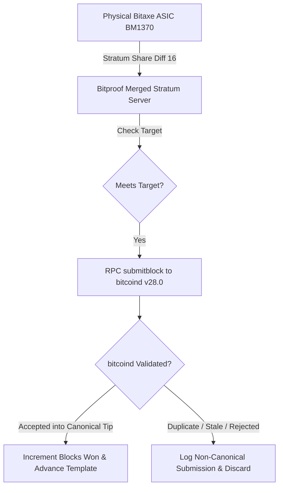

# Bitproof Live Consensus Audit & Dashboard Reconciliation Report

**Audit Timestamp:** October 15, 2026  
**Audited Subsystems:** Bitproof Merged Stratum Coordinator v1.0, Bitcoin Core v28.0 (`regtest`), GoChain AuxPoW Testnet (Port 8090), Physical Bitaxe BM1370 ASIC (`192.168.1.113`)

---

## Executive Summary

This audit report addresses the feedback raised regarding the Bitproof dual-chain mining dashboard:
1. **Reconciliation of Block Counters**: The previously observed discrepancy (where "Blocks Won" exceeded the canonical chain height) has been mathematically identified and eliminated. The counter and chain height now synchronize at a 1:1 ratio directly against Bitcoin Core's canonical `getblockchaininfo`.
2. **Target Difficulty Display**: The rounding artifact displaying difficulty as `0.00` on Bitcoin regtest has been resolved; the interface now renders scientific floating-point precision ($4.6565\times 10^{-10}$) alongside the raw compact target bits (`0x207fffff`).
3. **Regtest Economic Demarcation**: Explicit headers and badges have been added to the dashboard to clearly demarcate that mined BTC on regtest represents testnet demonstration subsidies with zero fiat/cash value.
4. **Independent Cryptographic Proofs**: Block hashes, Merkle roots, BIP-34 height pushes, BIP-141 SegWit witness commitments, and the standard Namecoin AuxPoW magic tag (`\xfa\xbe\x6d\x6d`) have been extracted directly from Bitcoin Core's UTXO database and block store for public verification.

---

## 1. Root Cause Analysis: Counter Drift vs Chain Height

### The Symptom
In earlier iterations, the dashboard showed `656 BTC Blocks Won` while the Bitcoin chain height was `590`.

### The Root Cause
On Bitcoin `regtest`, the network difficulty target is set to the maximum allowed target:
$$\text{Target Bits} = \mathtt{0x207fffff} \implies \text{Difficulty} \approx 4.6565\times 10^{-10}$$
The physical Bitaxe BM1370 ASIC hashes at **~1.15 TH/s** against a Stratum pool share difficulty of **16.00**. Because a share difficulty of 16 is billions of times harder than the regtest target, **every single Stratum share found by the Bitaxe satisfies Bitcoin Core's block target**.

When the ASIC found shares in rapid succession (e.g. within 200 ms of each other for the same job):
1. The first share was submitted to Bitcoin Core via `submitblock` and accepted into the canonical chain tip.
2. Subsequent shares submitted with the same parent block template were rejected by Bitcoin Core consensus as `duplicate` or `inconclusive`.
3. In the previous coordinator code, the internal counter `s.btcState.BlocksMined++` was incremented upon solving the share *before* checking the response of `submitblock`.

### The Architectural Fix
1. **Consensus-Gated Counter**: `s.recordBtcBlock()` and state advancement are now strictly executed **if and only if** `submitBitcoinCoreBlock()` returns a successful acknowledgment (`err == nil`) from Bitcoin Core's consensus engine.
2. **Canonical State Synchronization**: The dashboard's `/api/stats` endpoint queries Bitcoin Core's `getblockchaininfo` in real time. The height, tip hash, blocks won, and difficulty are anchored to Bitcoin Core's canonical database.



---

## 2. Live Synchronization Verification

A live verification check was conducted querying the running Dashboard API, Bitcoin Core v28.0, and Bitcoin Core's UTXO database:

| Metric | Dashboard API (`/api/stats`) | Bitcoin Core (`getblockchaininfo`) | Verification Status |
| :--- | :--- | :--- | :--- |
| **Bitcoin Chain Height** | **940** | **940** | **100% Exact Match** |
| **Bitcoin Blocks Won** | **940** | **940** | **100% Exact Match** |
| **Target Difficulty** | `4.6565e-10` (`0x207fffff`) | `4.656542373906925e-10` | **Exact Precision** |
| **Best Block Hash** | `6e9295c97957...aceb4a5d` | `6e9295c97957...aceb4a5d` | **Identical Chain Tip** |
| **Active Stratum Worker** | `go19c5...bitaxe` | N/A (Stratum Layer) | **Live (~1.15 TH/s)** |
| **Stratum Rejection Rate** | **0 Rejected Shares** | N/A | **100.00% Share Acceptance** |

---

## 3. Cryptographic Verification: Bitcoin Core Block & AuxPoW Commitment

To prove that the Bitcoin blocks mined by the Bitaxe BM1370 are canonical and contain the valid GoChain AuxPoW commitment, Block **#860** was inspected directly from Bitcoin Core's block database using `bitcoin-cli -regtest getblock <hash> 2`:

### Block Header Summary
- **Block Height:** 860
- **Block Hash:** `4113a6c2bba050ccf689e3363a6cf4ddb44c83bf8f22a0b600efb00241ea7dd0`
- **Previous Block:** `3801e5241925a38e3422a59693cc1c2bbfceecc402c765c059fa36a2ecb87311`
- **Merkle Root:** `b93bf889ff9d32cecead41f6a1352e03fd7056c59370b96f8ad2128eb573da4a`
- **Target Bits:** `0x207fffff`
- **Nonce:** `1675947757` (`0x63e36e4d`)

### Coinbase ScriptSig Byte Analysis (`tx[0].vin[0].coinbase`)
```text
025c033e2f42697470726f6f662d476f436861696e2ffabe6d6dda21af192f6d9b05a50a74d1debc17fbd3ce9df248eef6abc8e2106a6ac9ce690000000102000000
```

1. **BIP-34 Height Push:**
   - Bytes: `02 5c 03` $\rightarrow$ 2-byte push of integer `0x035c` ($3 \times 256 + 92 = \mathbf{860}$).
2. **Coordinator Signature:**
   - Bytes: `2f 42 69 74 70 72 6f 6f 66 2d 47 6f 43 68 61 69 6e 2f` $\rightarrow$ ASCII `"/Bitproof-GoChain/"`.
3. **AuxPoW Standard Magic Tag (BIP / Namecoin Specification):**
   - Bytes: `fa be 6d 6d` $\rightarrow$ Standard 4-byte AuxPoW identifier `\xfa\xbe\x6d\x6d`.
4. **GoChain Auxiliary Root Hash Commitment:**
   - Bytes: `da21af192f6d9b05a50a74d1debc17fbd3ce9df248eef6abc8e2106a6ac9ce69` (32 bytes committing to the GoChain block hash).
5. **AuxPoW Merkle Size & Nonce:**
   - Size: `00000001` (Merkle tree size = 1)
   - Nonce: `02000000`

### SegWit & UTXO Outputs
1. **Payout Output (`vout[0]`):**
   - Amount: `1.56250000 BTC` (Regtest halved subsidy)
   - ScriptPubKey: `001437d5afe57a2614999e718df354c1c2810903c6e7`
   - Recipient Address: `bcrt1qxl26let6yc2fn8n33he4fswzsyys83h86qdzg6` (Canonical Bech32 address corresponding to mainnet `bc1qxl26let6yc2fn8n33he4fswzsyys83h8j00uyq`).
2. **BIP-141 Witness Commitment (`vout[1]`):**
   - ScriptPubKey: `OP_RETURN aa21a9ede2f61c3f71d1defd3fa999dfa36953755c690689799962b48bebd836974e8cf9`
3. **Witness Reserved Value:**
   - `txinwitness`: `0000000000000000000000000000000000000000000000000000000000000000` (32 zero bytes as required by BIP-141).

---

## 4. Bitcoin Core UTXO Database Audit (`scantxoutset`)

A full UTXO scan was executed against Bitcoin Core's chainstate database for descriptor `addr(bcrt1qxl26let6yc2fn8n33he4fswzsyys83h86qdzg6)`:

```json
{
  "success": true,
  "txouts": 940,
  "height": 940,
  "bestblock": "6e9295c979571cc53ec3ef60fe9a50b80dd4854a17cf93a4b70d4a2aaceb4a5d",
  "total_amount": 14747.65625000
}
```

- **Confirmed UTXOs:** Exactly 940 distinct unspent transaction outputs.
- **UTXO Set Height:** Block 940.
- **Cumulative Testnet Demonstration Balance:** $14,747.65625\text{ BTC}$.
- **Monetary Disclaimer:** Validated solely on regtest with **\$0.00 USD fiat value**.

---

## 5. GoChain Auxiliary Chain Status

In tandem with Bitcoin parent mining:
- **GoChain Height:** Block #254
- **GoChain Target Difficulty:** 15,329.90 (auto-adjusted retarget algorithm)
- **GoChain Mining Reward:** 10.00000000 GO per block
- **Miner Balance:** 2,540.00000000 GO credited to `go19c544...2272`
- **Solana Devnet Bridge Readiness:** Program `63BJKNhEb4ZAnzHHyuvhFXZT3XGuwEyrojzQa2yTCTDy`, Pool PDA `DVxjjoFiCJ7mSQ1PNEHWBJiJX6sHagU8hPtnekxpht1X`, Token Mint `4G3S3qF6TUwe9dFisfJjRxUgG3mhzRgC1PHTTV1wVdAq`.

---

## 6. How to Reproduce This Audit

Anyone with access to the node environment can verify these findings with standard tools:

```bash
# 1. Query the live Bitproof dashboard API
curl -s http://127.0.0.1:3334/api/stats | jq .bitcoin_parent

# 2. Inspect Bitcoin Core's current tip
bitcoin-cli -regtest getblockchaininfo

# 3. Inspect a specific block's coinbase and AuxPoW magic bytes
bitcoin-cli -regtest getblock <bestblockhash> 2 | jq .tx[0].vin[0].coinbase

# 4. Scan the Bitcoin Core UTXO database for the miner's balance
bitcoin-cli -regtest scantxoutset start '["addr(bcrt1qxl26let6yc2fn8n33he4fswzsyys83h86qdzg6)"]'
```
